<div align="center">

# Zeszyt Tenisisty

**Kariera od ściany za blokiem po Wimbledon — zapisana w jednym zeszycie.**

Gra o karierze polskiego tenisisty lub tenisistki. Masz 8 lat, rakietę z piwnicy i pusty zeszyt. Każdej zimy rozpisujesz treningi, wybierasz trenera, podpisujesz umowy i odbijasz pieczątki w terminarzu. Przed ważnymi meczami czytasz raport skauta i zagrywasz kartę taktyki. Na końcu z zeszytu powstaje hasło w encyklopedii — i **Dorobek**, który trafia na tablicę wyników.

`TypeScript` · `React 18` · `Vite` · `Fastify 5` · `PostgreSQL` · `Prisma` · `Vitest` · `Docker`

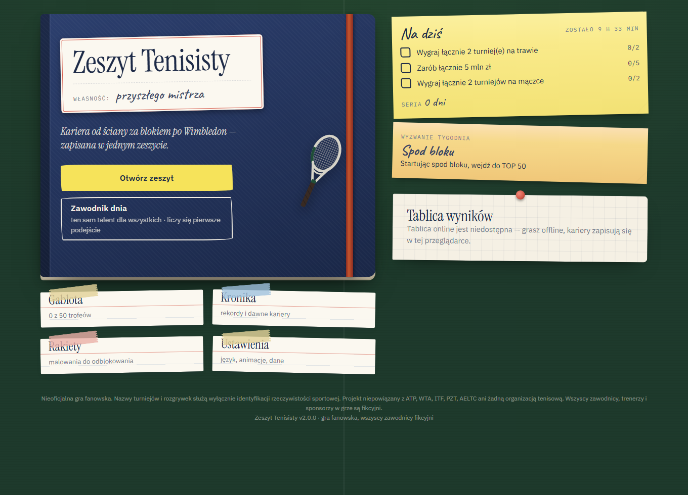

</div>

---

## Spis treści

1. [Koncepcja](#koncepcja)
2. [Jak się gra](#jak-się-gra)
3. [Zrzuty ekranu](#zrzuty-ekranu)
4. [Szybki start](#szybki-start)
5. [Architektura w skrócie](#architektura-w-skrócie)
6. [Struktura projektu](#struktura-projektu)
7. [Skrypty](#skrypty)
8. [Testy i jakość](#testy-i-jakość)
9. [Wdrożenie](#wdrożenie)
10. [Dokumentacja](#dokumentacja)
11. [Licencja i zastrzeżenia](#licencja-i-zastrzeżenia)

---

## Koncepcja

Cały interfejs to **jeden przedmiot**: zeszyt zawodnika leżący na biurku obitym zielonym suknem w kolorze kortu. Nie ma tu ciemnego panelu z paskami — każdy element gry ma swój odpowiednik na papierze:

| W grze | W zeszycie |
|---|---|
| menu | okładka z naklejką „Własność:”, karteczki z celami na dziś, tablica wyników przypięta pinezką |
| statystyki | **legitymacja zawodnika**: polaroid, radar 7 umiejętności, prognoza formy jako pogoda, bateria zmęczenia, czucie nawierzchni jako mini-korty |
| kalendarz | turnieje jako **pieczątki pocztowe** w kolorze nawierzchni |
| mecze | **protokół turnieju** jak arkusz sędziowski + oś sezonu pisana długopisem |
| ważny mecz | **teczka skauta** i ręka **kart taktyk** |
| wydarzenia | listy poza sezonem, SMS-y w trakcie |
| koniec sezonu | wycinek z gazety |
| emerytura | **hasło w encyklopedii** generowane z kariery + pieczęć Dorobku |

Szczegóły: [docs/GAME_DESIGN.md](docs/GAME_DESIGN.md) · [docs/DESIGN_SYSTEM.md](docs/DESIGN_SYSTEM.md).

## Jak się gra

**Ścieżka:** Tenis 10 (8–10 lat) → ranking krajowy → Tennis Europe (Les Petits As, Mistrzostwa Europy) → ITF Juniors (juniorskie Szlemy, Orange Bowl) → zawodowstwo: ITF M15/M25, Challengery we Wrocławiu, Poznaniu i Szczecinie, turnieje 250/500/1000, **Wielkie Szlemy**, Finały, Igrzyska.

**Zima — trening blokowy.** Masz 5–7 bloków. Każdy kolejny blok na tę samą umiejętność daje mniej, więc wybierasz między specjalizacją a wszechstronnością. Bloki możesz też wydać na odpoczynek (mniej kontuzji) albo na naukę **nowej karty taktyki** — ale tylko takiej, której uczy twój obecny trener.

**Talia taktyk.** 12 kart planu gry: *Solidnie z głębi*, *Atak na bekhend*, *Serwis i pierwszy forhend*, *Wojna na wyniszczenie*, *Wysokie topspiny*, *Return w nogi*, *Skróty i loby*, *Forhend z odwrotnego krosa*, *Serwis i wolej*, *Chip and charge*, *Gra w głowie rywala*, *Wszystko albo nic*. Każda działa inaczej na **cztery style rywali** (bombardier serwisowy, ściana z głębi kortu, wszechstronny, siatkarz) i na różnych nawierzchniach, ma swoje **ryzyko** (huśtawkę w każdym secie) i **mistrzostwo** rosnące z wygranymi. Przed ważnym meczem czytasz raport skauta i zagrywasz kartę; w zwykłych meczach gra twój „plan na co dzień”.

**Sezon.** Terminarz układasz tydzień po tygodniu (gra podpowiada, czy wejdziesz do drabinki, przez kwalifikacje czy z dziką kartą). Mecze są liczone punkt po punkcie — tie-breaki, best-of-5 w Szlemach mężczyzn, nawierzchnie, forma, zmęczenie. Ranking to rolling 52 tygodnie wśród 420 zawodników, którzy się starzeją i odchodzą. Twój juniorski **Nemesis** idzie z tobą przez całą karierę.

**Metagra.** Zawodnik dnia (wspólny talent, liczy się pierwsze podejście), tablica wyników (dziś / tydzień / wszech czasów), cele dnia i wyzwanie tygodnia, seria, **gablota z 50 trofeami**, kronika, kolekcja 15 malowań rakiet. Interfejs po polsku i angielsku.

## Zrzuty ekranu

| | |
|---|---|
| 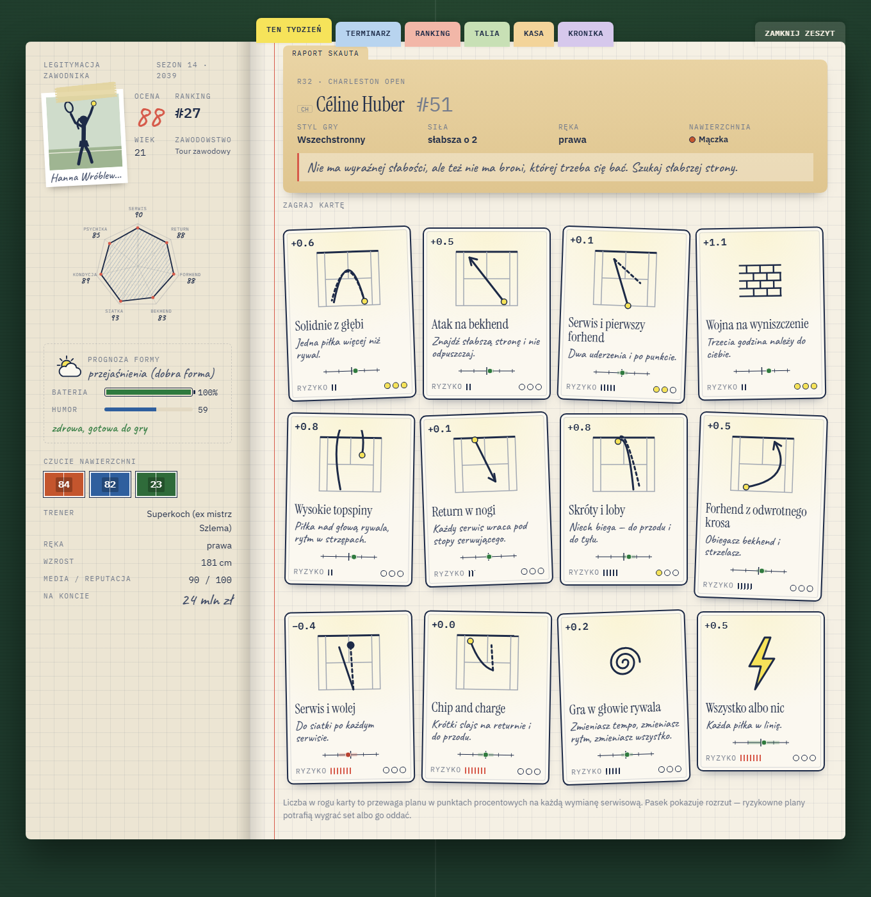 | 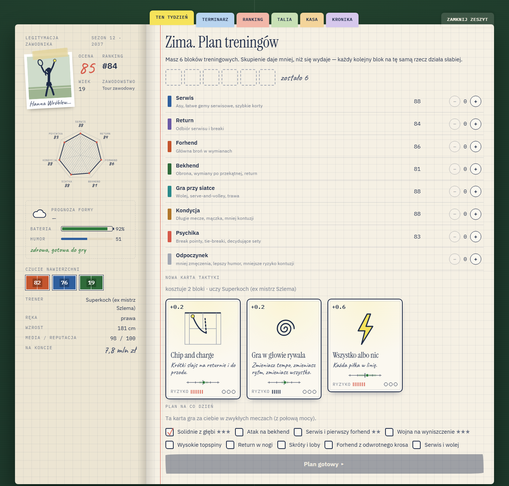 |
| **Raport skauta** — teczka o rywalce i ręka kart taktyk z przewagą, rozrzutem i mistrzostwem | **Zima** — planer bloków treningowych, nauka nowej karty, legitymacja z radarem |
| 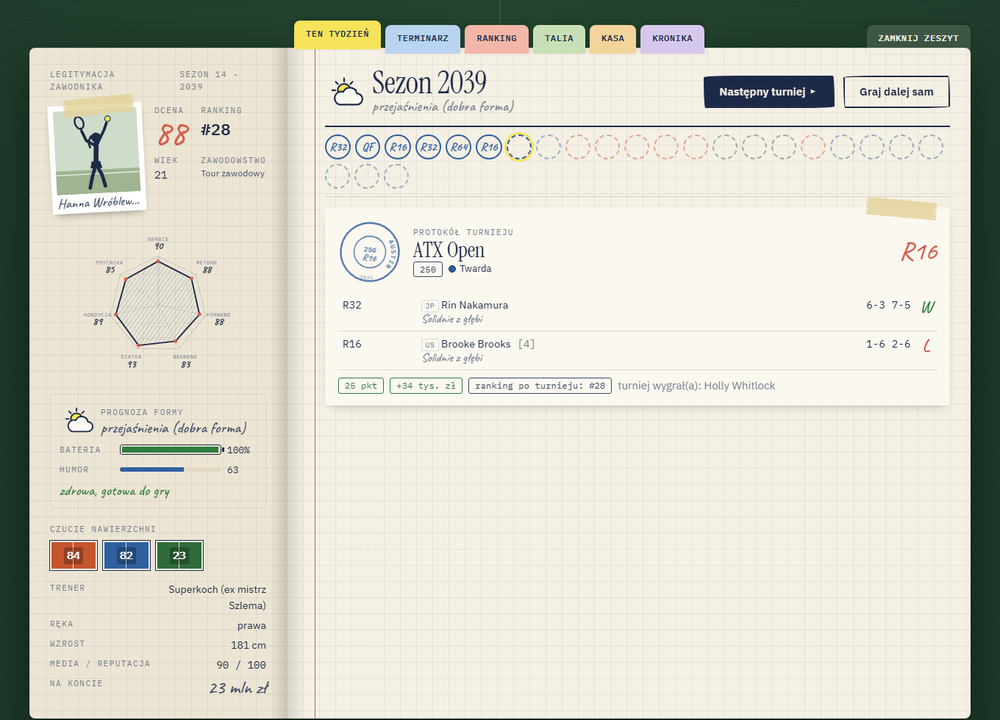 | 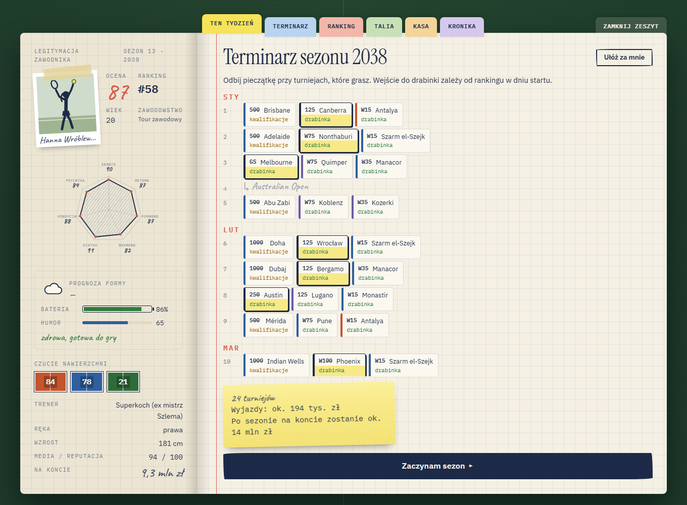 |
| **Sezon** — oś z wynikami i protokół turnieju z kartami użytymi w meczach | **Terminarz zawodowy** — tydzień po tygodniu, z prognozą wejścia do drabinki |
| 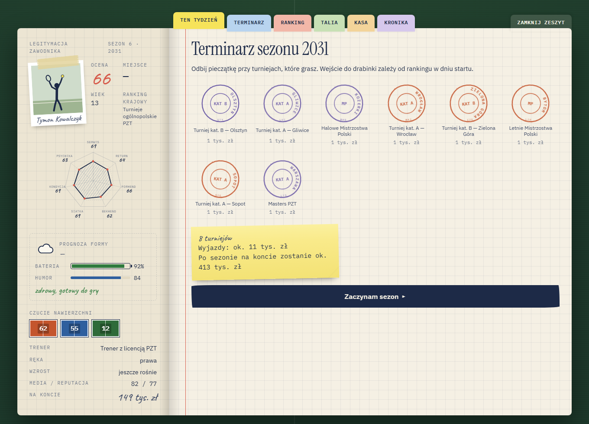 | 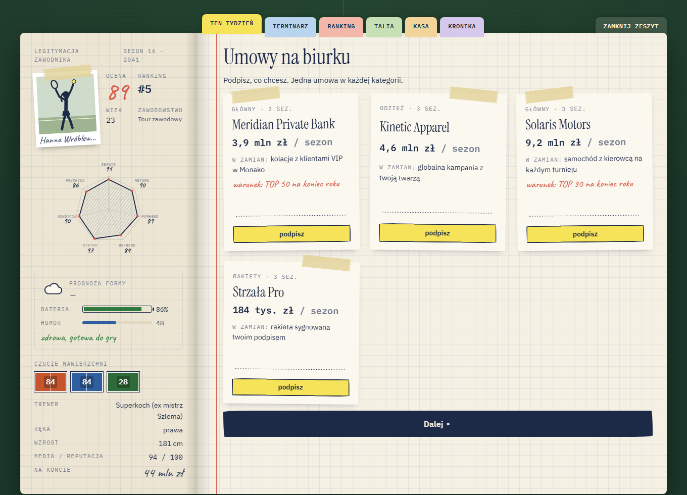 |
| **Terminarz juniora** — turnieje jako pieczątki do odbicia | **Umowy** — kontrakty sponsorskie z linią podpisu |
| 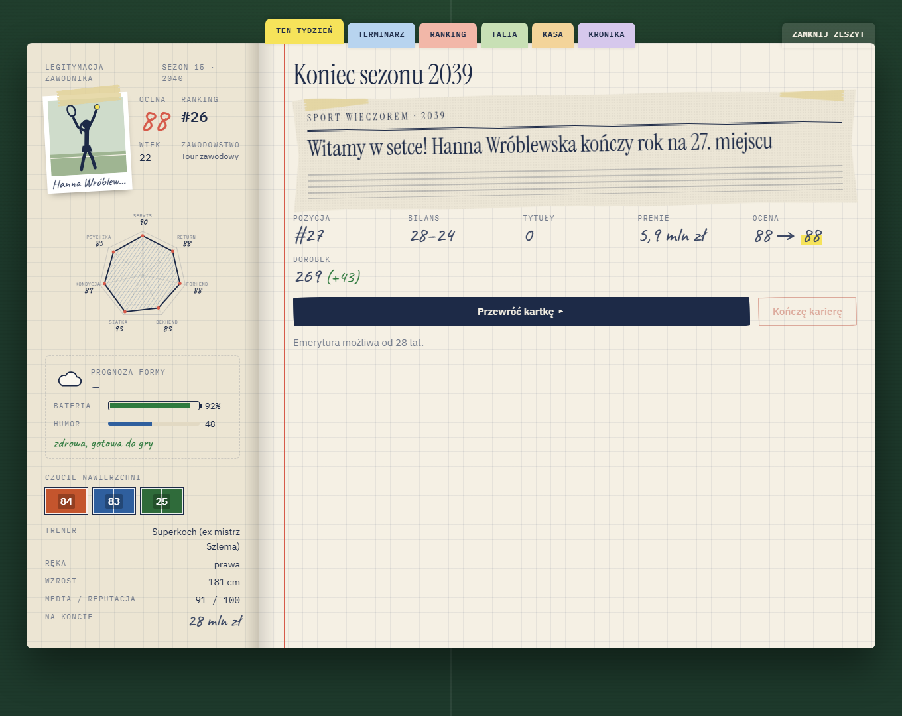 | 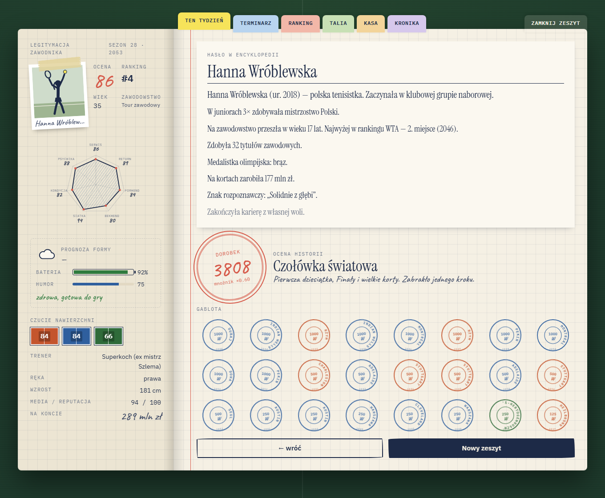 |
| **Koniec sezonu** — wycinek z gazety i notatki z bilansem | **Emerytura** — hasło w encyklopedii, pieczęć Dorobku, gablota |
| 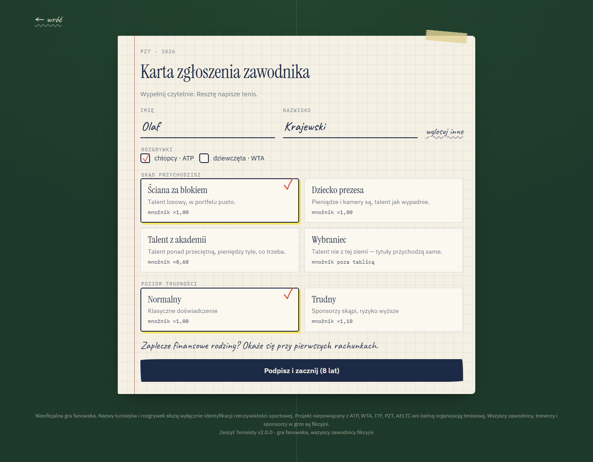 | |
| **Nowa kariera** — karta zgłoszenia zawodnika | |

## Szybki start

### Wymagania
- **Node.js ≥ 20.11** (zalecany 22 — `.nvmrc`)
- **Docker** — tylko jeśli chcesz rankingi online (PostgreSQL)

### Gra offline (bez serwera)

```bash
npm install
npm run dev
```

Otwórz http://localhost:5173. Kariery zapisują się w przeglądarce, osiągnięcia i muzeum działają lokalnie.

### Pełny stos z rankingami online

```bash
npm install
cp apps/api/.env.example apps/api/.env
cp apps/web/.env.example apps/web/.env.local
npm run db:up          # PostgreSQL w Dockerze
npm run db:migrate     # schemat bazy
npm run dev:api        # API na http://localhost:4000
npm run dev            # gra na http://localhost:5173
```

### Wszystko w Dockerze

```bash
docker compose up --build
```

Gra: http://localhost:8080 · API: http://localhost:4000/health

## Architektura w skrócie

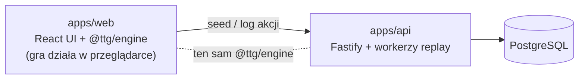

- **Deterministyczny silnik** (`packages/engine`) — cała gra to czysty reducer `step(state, action)`. Losowość wyłącznie z seedowanego PRNG zapisanego w stanie.
- **Gra offline-first** — symulacja działa w przeglądarce, zapis = seed + log akcji + snapshot.
- **Uczciwe rankingi** — serwer wydaje seed, a po zakończeniu kariery **sam ją odtwarza** z logu decyzji (replay w `worker_threads`). Wynik klienta jest ignorowany; zmanipulowany log zostaje odrzucony.
- **Wspólne kontrakty** (`packages/shared`) — schematy zod walidowane po obu stronach.

Szczegóły: [docs/ARCHITECTURE.md](docs/ARCHITECTURE.md) · decyzje: [docs/adr](docs/adr).

## Struktura projektu

```
tennis-the-game/
├── packages/
│   ├── engine/        @ttg/engine — symulacja, treść gry, testy, raport balansu
│   └── shared/        @ttg/shared — kontrakty API (zod)
├── apps/
│   ├── web/           @ttg/web — klient React + Vite
│   └── api/           @ttg/api — Fastify + Prisma + PostgreSQL
├── docs/              dokumentacja projektowa i techniczna
├── docker-compose.yml PostgreSQL + API + web (nginx)
└── .github/           CI: lint · typecheck · test · build · smoke test API na PostgreSQL
```

## Skrypty

| Komenda | Opis |
|---|---|
| `npm run dev` | klient na :5173 |
| `npm run dev:api` | API na :4000 (wymaga bazy) |
| `npm run build` | produkcyjny build klienta i API |
| `npm test` | testy (Vitest) |
| `npm run lint` · `npm run typecheck` · `npm run format` | jakość kodu |
| `npm run balance -- 40` | raport balansu: 40 karier botem na każdy punkt startowy |
| `npm run db:up` · `npm run db:migrate` | baza w Dockerze, migracje |
| `npm run ci` | pełny pipeline lokalnie |
| `API_URL=http://localhost:4000 npx tsx apps/api/scripts/smoke.ts` | test end-to-end działającego API |

## Testy i jakość

- **51 testów jednostkowych** (silnik + API): determinizm RNG, legalność wyników setów, kalibracja modelu meczu, rozstawienie drabinek, ranking 52-tygodniowy, karty taktyk (przewaga, limity, nauczyciele), trening blokowy (malejące zyski, odpoczynek), obsady turniejów (pasma rankingowe, poziomy juniorskie) i prognoza szans, pełne kariery botem, **replay identyczny bit w bit**, odrzucanie zmanipulowanych logów, integralność treści PL/EN.
- **Smoke test end-to-end** na prawdziwym PostgreSQL (także w CI): konto → kariera → weryfikacja → rankingi → zasada jednego podejścia Kariery Dnia.
- **Raport balansu** — rozkłady najwyższego rankingu, LEGACY, Szlemów i werdyktów dla każdego punktu startowego ([docs/ENGINE.md §9](docs/ENGINE.md#9-balans--jak-sprawdzać)).
- TypeScript `strict` + `noUncheckedIndexedAccess`, ESLint (typescript-eslint, react-hooks), Prettier.

## Wdrożenie

| Komponent | Artefakt | Uwagi |
|---|---|---|
| Klient | statyczne pliki (`apps/web/dist`) / obraz nginx | `VITE_API_URL` przy buildzie; bez niego gra działa offline |
| API | obraz Node 22 (`apps/api/Dockerfile`) | migracje `prisma migrate deploy` przy starcie; `VERIFY_WORKERS` = liczba wątków replayu |
| Baza | PostgreSQL 16+ | jedna instancja wystarcza; rankingi korzystają z indeksów złożonych |

Zmienne środowiskowe API: [`apps/api/.env.example`](apps/api/.env.example). Kontener API wystawia `GET /health` i `GET /health/db`.

> **Wersja silnika**: klient i API wdrażamy razem. Zmiana wpływająca na wynik symulacji = nowy `ENGINE_VERSION` ([docs/ARCHITECTURE.md §7](docs/ARCHITECTURE.md#7-wersjonowanie-silnika)).

## Dokumentacja

| Dokument | Zawartość |
|---|---|
| [GAME_DESIGN.md](docs/GAME_DESIGN.md) | zamysł gry: pętla, etapy kariery, systemy, punkty, pieniądze, LEGACY, metagra |
| [ARCHITECTURE.md](docs/ARCHITECTURE.md) | komponenty, przepływy, model zaufania, wydajność |
| [ENGINE.md](docs/ENGINE.md) | silnik: maszyna faz, model meczu (wzory), turnieje, ranking, rozwój, ekonomia, balans |
| [DATABASE.md](docs/DATABASE.md) | schemat bazy z diagramem ER, indeksy, cykl życia kariery |
| [API.md](docs/API.md) | endpointy, kontrakty, błędy, limity, przykłady |
| [CONTENT_GUIDE.md](docs/CONTENT_GUIDE.md) | jak pisać wydarzenia, karty taktyk, turnieje, osiągnięcia |
| [DESIGN_SYSTEM.md](docs/DESIGN_SYSTEM.md) | metafora zeszytu, mapa przedmiotów, tokeny, typografia, ruch, dostępność |
| [ROADMAP.md](docs/ROADMAP.md) | plan rozwoju |
| [adr/](docs/adr) | decyzje architektoniczne |
| [CONTRIBUTING.md](CONTRIBUTING.md) · [CHANGELOG.md](CHANGELOG.md) · [SECURITY.md](SECURITY.md) | praca z repozytorium |

## Licencja i zastrzeżenia

Kod zastrzeżony — patrz [LICENSE](LICENSE).

*Nieoficjalna gra fanowska. Nazwy turniejów, rozgrywek i obiektów służą wyłącznie identyfikacji rzeczywistości sportowej. Projekt niepowiązany z ATP, WTA, ITF, PZT, AELTC ani żadną organizacją tenisową. Wszyscy zawodnicy, trenerzy i sponsorzy w grze są fikcyjni.*
