<div align="center">

# Symulator Polskiego Tenisisty

**Od ściany za blokiem po Centre Court. Tata już naciągnął rakietę, reszta należy do ciebie.**

Tekstowy symulator kariery tenisowej: zaczynasz jako 8-latek w turniejach Tenisa 10, przechodzisz przez Mistrzostwa Polski, Tennis Europe i juniorskie Szlemy, grzebiesz się w ITF-ach w Monastirze — i walczysz o Wimbledon.
Każdy sezon to decyzje. Każda decyzja ma szansę. Historia ocenia cię jedną liczbą: **LEGACY**.

`TypeScript` · `React 18` · `Vite` · `Fastify 5` · `PostgreSQL` · `Prisma` · `Vitest` · `Docker`

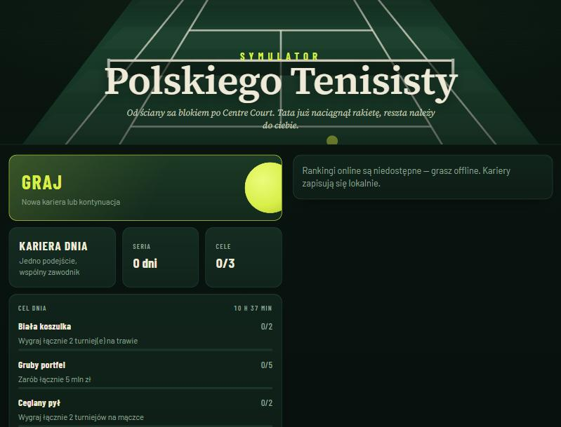 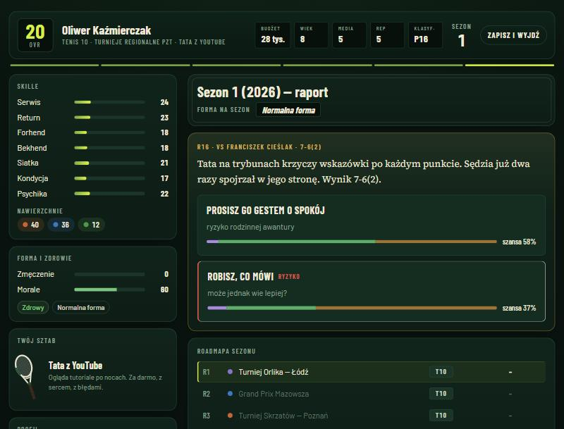

</div>

---

## Spis treści

1. [O grze](#o-grze)
2. [Zrzuty ekranu](#zrzuty-ekranu)
3. [Szybki start](#szybki-start)
4. [Architektura w skrócie](#architektura-w-skrócie)
5. [Struktura projektu](#struktura-projektu)
6. [Skrypty](#skrypty)
7. [Testy i jakość](#testy-i-jakość)
8. [Wdrożenie](#wdrożenie)
9. [Dokumentacja](#dokumentacja)
10. [Licencja i zastrzeżenia](#licencja-i-zastrzeżenia)

---

## O grze

Gra jest inspirowana *Symulatorem Polskiego Kierowcy* — ta sama filozofia krótkich, gęstych decyzji z jawnymi szansami — ale w całości zbudowana wokół tenisa.

### Ścieżka kariery

| Etap | Wiek | Co grasz |
|---|---|---|
| **Tenis 10** | 8–10 | turnieje regionalne, Mistrzostwa Polski Tenisa 10 |
| **Ranking krajowy** | 11–13 | turnieje kat. A/B, Halowe i Letnie Mistrzostwa Polski |
| **Tennis Europe** | 14–15 | Les Petits As w Tarbes, Trofeo Avvenire, Mistrzostwa Europy |
| **ITF Juniors** | 16–17 | J60–J500, Orange Bowl, juniorskie AO / Roland Garros / Wimbledon / US Open |
| **Zawodowstwo** | 18–38 | ITF M15/M25, Challengery (Wrocław, Poznań, Szczecin), ATP/WTA 250/500/1000, **Wielki Szlem**, Finały, Igrzyska |

### Co składa się na sezon

- **Wydarzenia fabularne** — tata kłóci się z sędzią na Orlikach, hala pneumatyczna przecieka przed Mistrzostwami Polski, akademia w Barcelonie, menedżer z Monako, powołanie do Pucharu Davisa / BJK Cup, hejt po pierwszej rundzie Szlema. Wybory z jawnymi skutkami i rzutami.
- **Trening zimowy** — wybierasz, który skill podkręcasz (7 umiejętności: serwis, return, forhend, bekhend, siatka, kondycja, psychika).
- **Sztab** — od „Taty z YouTube” po superkocha, ex-mistrza Szlema; fizjoterapeuta, trener przygotowania.
- **Sponsorzy** — od Piekarni u Zenka po globalne marki (fikcyjne), z warunkami typu „TOP 100 na koniec roku”.
- **Plan sezonu** — w zawodowstwie wybierasz turniej na każdy tydzień; gra pokazuje, czy wejdziesz do drabinki (MD), przez kwalifikacje (Q), czy z szansą na dziką kartę.
- **Mecze** — symulowane punkt po punkcie: nawierzchnie, tie-breaki, best-of-5 w Szlemach mężczyzn, punkty pod presją. W kluczowych meczach symulacja staje i pyta, co robisz przy break poincie — a **ruletka szans** pokazuje SUPER / SUKCES / PORAŻKĘ.
- **Ranking** — rolling 52 tygodnie, 19 najlepszych wyników, 420 zawodników AI, którzy się starzeją, rozwijają i odchodzą. Twój juniorski **Nemesis** idzie z tobą przez całą karierę.

### Metagra

**Kariera Dnia** (wspólny zawodnik i seed, liczy się pierwsze podejście) · **rankingi** dzienne, tygodniowe i wszech czasów z panującym mistrzem · **cele dnia** i **wyzwanie tygodnia** · **seria** dni · **48 osiągnięć** · **Muzeum kariery** · **kolekcja 15 malowań rakiet** · PL / EN.

Pełny zamysł gry, liczby i formuły: **[docs/GAME_DESIGN.md](docs/GAME_DESIGN.md)**.

## Zrzuty ekranu

| | |
|---|---|
| 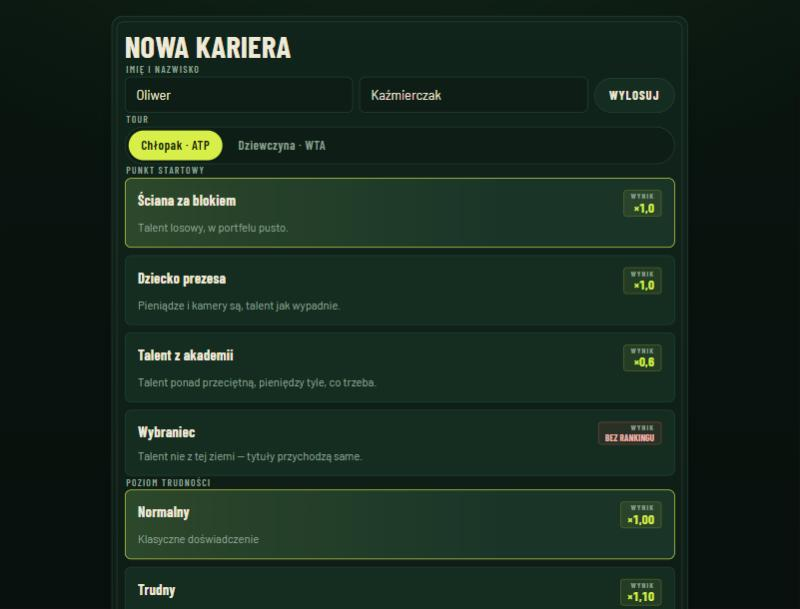 | 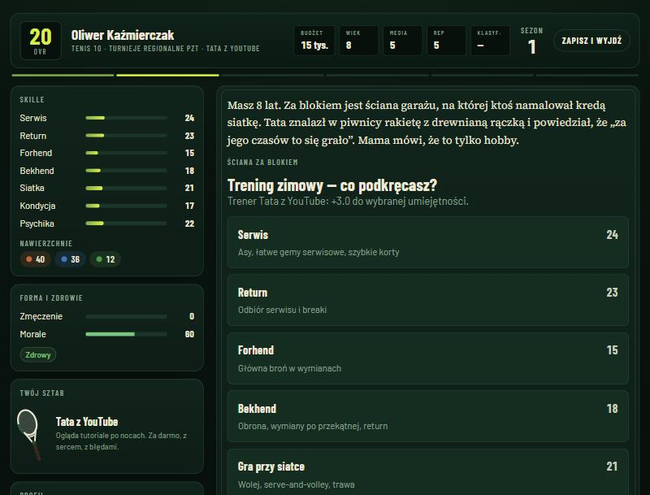 |
| **Nowa kariera** — punkt startowy i poziom trudności z mnożnikiem wyniku | **Trening zimowy** — HUD jak tablica wyników, panel skilli i sztabu |
| 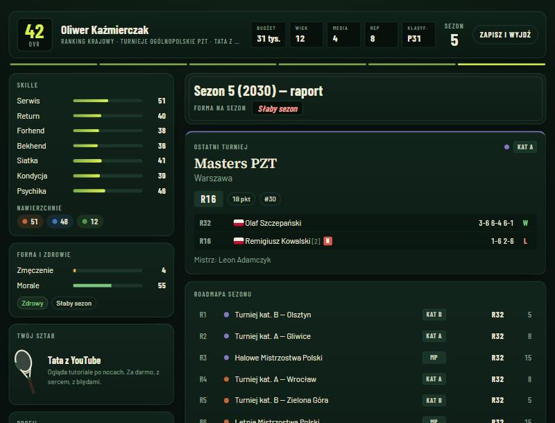 | 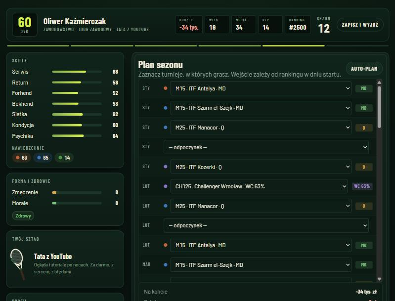 |
| **Raport sezonu** — ostatni turniej, mecze, roadmapa, Nemesis (N) | **Plan sezonu** — wejście MD / Q / dzika karta liczone z rankingu |
| 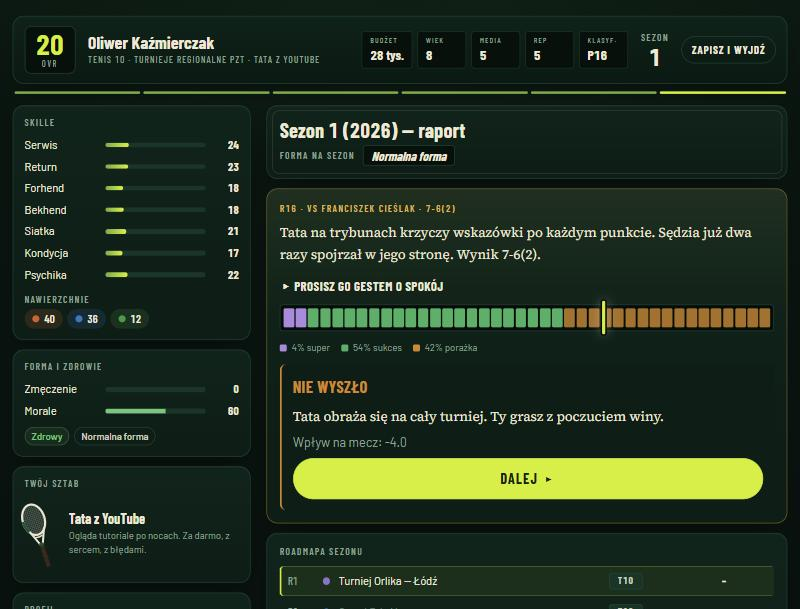 | 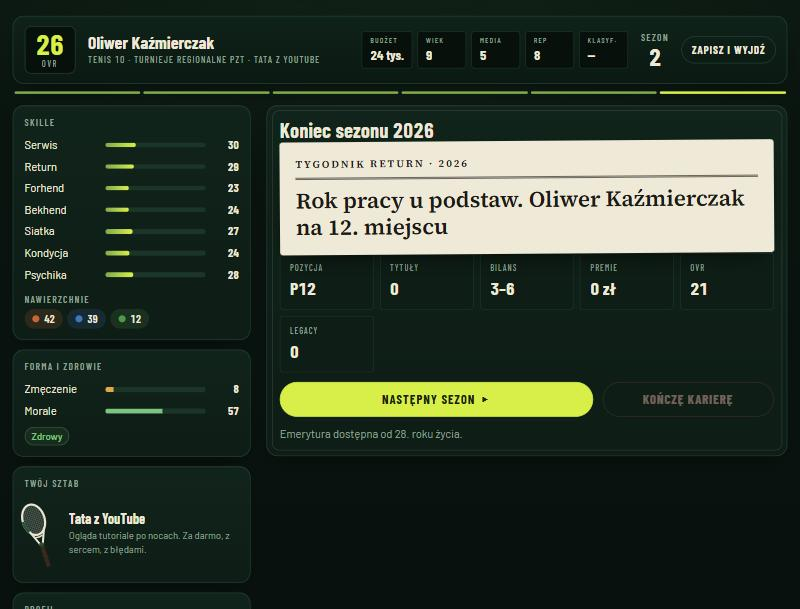 |
| **Ruletka szans** — wynik losuje silnik, UI tylko go odsłania | **Koniec sezonu** — nagłówek gazety, bilans, rozwój |
| 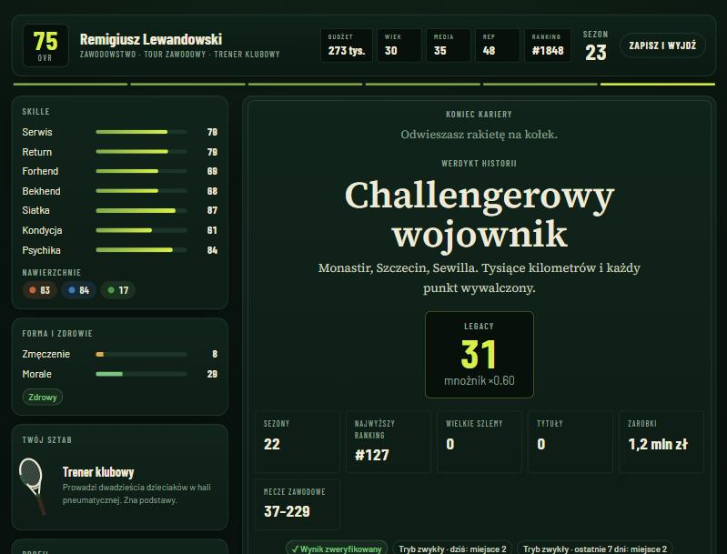 | 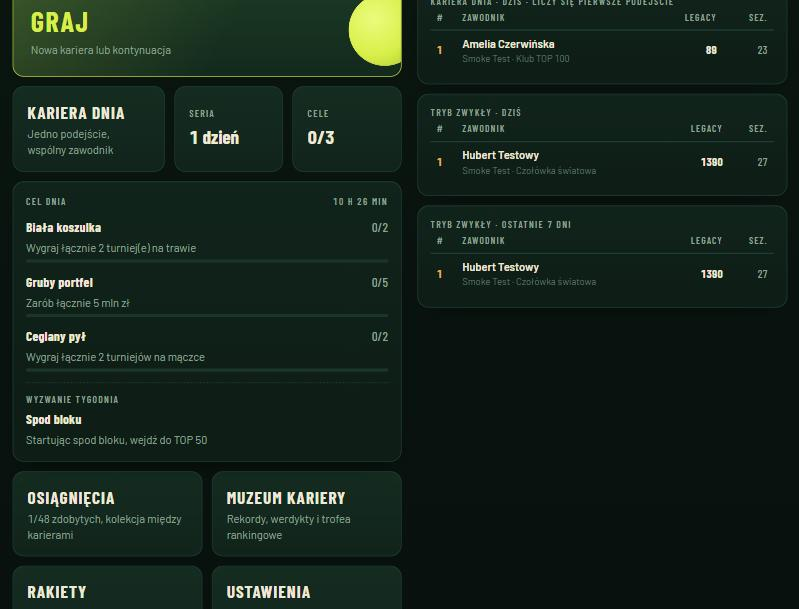 |
| **Werdykt historii** — LEGACY zweryfikowane przez serwer | **Rankingi online** — Kariera Dnia, dziś, 7 dni |

## Szybki start

### Wymagania
- **Node.js ≥ 20.11** (zalecany 22 — `.nvmrc`)
- **Docker** — tylko jeśli chcesz rankingi online (PostgreSQL)

### Gra offline (bez serwera)

```bash
npm install
npm run dev
```

Otwórz http://localhost:5173. Kariery zapisują się w przeglądarce, osiągnięcia i muzeum działają lokalnie.

### Pełny stos z rankingami online

```bash
npm install
cp apps/api/.env.example apps/api/.env
cp apps/web/.env.example apps/web/.env.local
npm run db:up          # PostgreSQL w Dockerze
npm run db:migrate     # schemat bazy
npm run dev:api        # API na http://localhost:4000
npm run dev            # gra na http://localhost:5173
```

### Wszystko w Dockerze

```bash
docker compose up --build
```

Gra: http://localhost:8080 · API: http://localhost:4000/health

## Architektura w skrócie

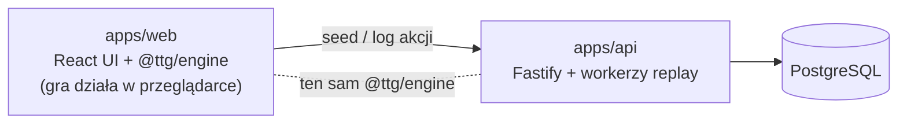

- **Deterministyczny silnik** (`packages/engine`) — cała gra to czysty reducer `step(state, action)`. Losowość wyłącznie z seedowanego PRNG zapisanego w stanie.
- **Gra offline-first** — symulacja działa w przeglądarce, zapis = seed + log akcji + snapshot.
- **Uczciwe rankingi** — serwer wydaje seed, a po zakończeniu kariery **sam ją odtwarza** z logu decyzji (replay w `worker_threads`). Wynik klienta jest ignorowany; zmanipulowany log zostaje odrzucony.
- **Wspólne kontrakty** (`packages/shared`) — schematy zod walidowane po obu stronach.

Szczegóły: [docs/ARCHITECTURE.md](docs/ARCHITECTURE.md) · decyzje: [docs/adr](docs/adr).

## Struktura projektu

```
tennis-the-game/
├── packages/
│   ├── engine/        @ttg/engine — symulacja, treść gry, testy, raport balansu
│   └── shared/        @ttg/shared — kontrakty API (zod)
├── apps/
│   ├── web/           @ttg/web — klient React + Vite
│   └── api/           @ttg/api — Fastify + Prisma + PostgreSQL
├── docs/              dokumentacja projektowa i techniczna
├── docker-compose.yml PostgreSQL + API + web (nginx)
└── .github/           CI: lint · typecheck · test · build · smoke test API na PostgreSQL
```

## Skrypty

| Komenda | Opis |
|---|---|
| `npm run dev` | klient na :5173 |
| `npm run dev:api` | API na :4000 (wymaga bazy) |
| `npm run build` | produkcyjny build klienta i API |
| `npm test` | testy (Vitest) |
| `npm run lint` · `npm run typecheck` · `npm run format` | jakość kodu |
| `npm run balance -- 40` | raport balansu: 40 karier botem na każdy punkt startowy |
| `npm run db:up` · `npm run db:migrate` | baza w Dockerze, migracje |
| `npm run ci` | pełny pipeline lokalnie |
| `API_URL=http://localhost:4000 npx tsx apps/api/scripts/smoke.ts` | test end-to-end działającego API |

## Testy i jakość

- **38 testów jednostkowych** (silnik + API): determinizm RNG, legalność wyników setów, kalibracja modelu meczu, rozstawienie drabinek, ranking 52-tygodniowy, pełne kariery botem, **replay identyczny bit w bit**, odrzucanie zmanipulowanych logów, integralność treści PL/EN.
- **Smoke test end-to-end** na prawdziwym PostgreSQL (także w CI): konto → kariera → weryfikacja → rankingi → zasada jednego podejścia Kariery Dnia.
- **Raport balansu** — rozkłady najwyższego rankingu, LEGACY, Szlemów i werdyktów dla każdego punktu startowego ([docs/ENGINE.md §9](docs/ENGINE.md#9-balans--jak-sprawdzać)).
- TypeScript `strict` + `noUncheckedIndexedAccess`, ESLint (typescript-eslint, react-hooks), Prettier.

## Wdrożenie

| Komponent | Artefakt | Uwagi |
|---|---|---|
| Klient | statyczne pliki (`apps/web/dist`) / obraz nginx | `VITE_API_URL` przy buildzie; bez niego gra działa offline |
| API | obraz Node 22 (`apps/api/Dockerfile`) | migracje `prisma migrate deploy` przy starcie; `VERIFY_WORKERS` = liczba wątków replayu |
| Baza | PostgreSQL 16+ | jedna instancja wystarcza; rankingi korzystają z indeksów złożonych |

Zmienne środowiskowe API: [`apps/api/.env.example`](apps/api/.env.example). Kontener API wystawia `GET /health` i `GET /health/db`.

> **Wersja silnika**: klient i API wdrażamy razem. Zmiana wpływająca na wynik symulacji = nowy `ENGINE_VERSION` ([docs/ARCHITECTURE.md §7](docs/ARCHITECTURE.md#7-wersjonowanie-silnika)).

## Dokumentacja

| Dokument | Zawartość |
|---|---|
| [GAME_DESIGN.md](docs/GAME_DESIGN.md) | zamysł gry: pętla, etapy kariery, systemy, punkty, pieniądze, LEGACY, metagra |
| [ARCHITECTURE.md](docs/ARCHITECTURE.md) | komponenty, przepływy, model zaufania, wydajność |
| [ENGINE.md](docs/ENGINE.md) | silnik: maszyna faz, model meczu (wzory), turnieje, ranking, rozwój, ekonomia, balans |
| [DATABASE.md](docs/DATABASE.md) | schemat bazy z diagramem ER, indeksy, cykl życia kariery |
| [API.md](docs/API.md) | endpointy, kontrakty, błędy, limity, przykłady |
| [CONTENT_GUIDE.md](docs/CONTENT_GUIDE.md) | jak pisać wydarzenia, sytuacje meczowe, turnieje, osiągnięcia |
| [DESIGN_SYSTEM.md](docs/DESIGN_SYSTEM.md) | kierunek wizualny, tokeny, typografia, ruch, dostępność |
| [ROADMAP.md](docs/ROADMAP.md) | plan rozwoju |
| [adr/](docs/adr) | decyzje architektoniczne |
| [CONTRIBUTING.md](CONTRIBUTING.md) · [CHANGELOG.md](CHANGELOG.md) · [SECURITY.md](SECURITY.md) | praca z repozytorium |

## Licencja i zastrzeżenia

Kod zastrzeżony — patrz [LICENSE](LICENSE).

*Nieoficjalna gra fanowska. Nazwy turniejów, rozgrywek i obiektów służą wyłącznie identyfikacji rzeczywistości sportowej. Projekt niepowiązany z ATP, WTA, ITF, PZT, AELTC ani żadną organizacją tenisową. Wszyscy zawodnicy, trenerzy i sponsorzy w grze są fikcyjni.*
