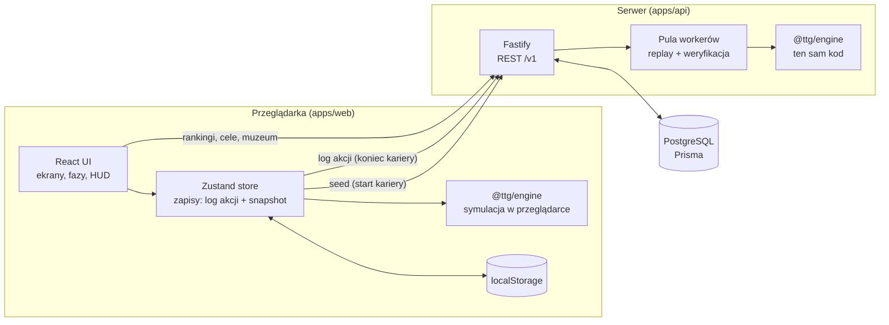

# Architektura

> Jak zbudowany jest Zeszyt Tenisisty i dlaczego właśnie tak.
> Decyzje projektowe z uzasadnieniem: [docs/adr](./adr).

## 1. Widok z lotu ptaka



Najważniejsza idea: **cała gra to deterministyczny reducer**. Ten sam pakiet `@ttg/engine` działa w przeglądarce (rozgrywka, offline) i na serwerze (weryfikacja). Serwer nie ufa wynikowi klienta — odtwarza karierę z ziarna (seed), które sam wydał, i z logu decyzji gracza.

## 2. Struktura repozytorium

```
tennis-the-game/
├── packages/
│   ├── engine/              @ttg/engine — symulacja (czysty TypeScript, zero zależności)
│   │   ├── src/
│   │   │   ├── rng.ts           seedowany PRNG xoshiro128**, stan serializowalny
│   │   │   ├── i18n.ts          typ L {pl,en}, znaczniki [[m|f]], interpolacja
│   │   │   ├── career.ts        createCareer / step / applyAction / replay (reducer)
│   │   │   ├── bot.ts           automatyczny gracz (testy, balans)
│   │   │   ├── model/           typy domeny, stałe balansu, skille, CareerSummary
│   │   │   ├── sim/             systemy: mecz, turniej, sezon, pole AI, ranking,
│   │   │   │                    rozwój, ekonomia, wydarzenia, taktyki, LEGACY
│   │   │   ├── content/         dane gry: turnieje, poziomy, trenerzy, sponsorzy,
│   │   │   │                    wydarzenia, karty taktyk, osiągnięcia, werdykty…
│   │   │   └── meta/            Kariera Dnia, cele dnia, wyzwanie tygodnia
│   │   ├── test/                Vitest: RNG, mecz, drabinki, ranking, kariery, replay
│   │   └── scripts/             raport balansu, diagnostyka trajektorii i fairness
│   └── shared/              @ttg/shared — kontrakty API (schematy zod)
├── apps/
│   ├── api/                 @ttg/api — Fastify + Prisma + PostgreSQL
│   │   ├── prisma/              schema.prisma + migracje SQL
│   │   ├── src/
│   │   │   ├── app.ts           budowa aplikacji, auth hook, obsługa błędów
│   │   │   ├── routes/          auth, careers, boards (rankingi, daily, muzeum)
│   │   │   ├── services/        rankingi, rozliczanie okresów, postęp, serializery
│   │   │   ├── verification/    verify (replay), worker, pula workerów
│   │   │   └── lib/             czas (Europe/Warsaw), tokeny
│   │   ├── scripts/smoke.ts     test end-to-end działającego API
│   │   └── test/
│   └── web/                 @ttg/web — React 18 + Vite
│       └── src/
│           ├── screens/         Home (biurko), Slots (zeszyty), NewCareer, Game (rozkładówka), Demo (dev)…
│           ├── phases/          ekrany faz kariery (Training, Team, Sponsors, Schedule,
│           │                    Season, Tactics (raport skauta), Event, SeasonEnd, Retired)
│           ├── panels/          zakładki: Terminarz, Ranking, Talia, Kasa, Kronika
│           ├── components/      Stamp, Radar, TacticCard, Weather, Polaroid, Signature, Racket, Dialog
│           ├── store/           game (zapisy, dispatch, submit), meta, settings
│           ├── i18n/            słownik UI PL/EN
│           ├── lib/             api client, format, efekty, storage, nawigacja
│           └── styles/          tokens.css, base.css, paper.css, screens.css
├── docs/                    dokumentacja (ten katalog)
├── docker-compose.yml       db + api + web
└── .github/workflows/ci.yml lint · typecheck · test · build
```

## 3. Silnik (`@ttg/engine`)

Szczegóły: [ENGINE.md](./ENGINE.md).

- **Reducer**: `step(state, action) → state`. Stan (`CareerState`) jest w 100% serializowalny do JSON — zawiera nawet stan generatora losowego.
- **Akcje** są małe i semantyczne (`train`, `team`, `sponsors`, `schedule`, `play`, `choose`, `continue`, `retire`). Typowa kariera to 800–3000 akcji.
- **Determinizm**: zero `Math.random()`, zero `Date.now()` w symulacji. Ten sam seed + ta sama lista akcji = bit w bit ten sam wynik (test `replays to the identical final state`).
- **Treść jako kod**: wydarzenia, sytuacje meczowe, kalendarze i osiągnięcia to typowane moduły TS. Warunki wydarzeń to funkcje (`condition: (state) => boolean`) — pełna moc języka, kontrola typów i testy integralności.

## 4. Klient (`apps/web`)

- **Offline-first.** Symulacja działa w przeglądarce. Zapis slotu = `{config, seed, actions[], snapshot}` w `localStorage`. Gdy snapshot nie zmieści się w limicie, zostaje sam log i stan odtwarzany jest replayem.
- **Online, gdy jest API.** Na start kariery klient prosi serwer o seed (`POST /v1/careers`). Po emeryturze wysyła log akcji (`POST /v1/careers/:id/finish`) i dostaje zweryfikowany wynik + pozycje w rankingach.
- **Stan UI**: Zustand (trzy małe store’y: `game`, `meta`, `settings`). Bez Reduxa — logika domenowa jest w silniku, store tylko ją woła i persystuje.
- **Routing**: `HashRouter` — statyczny hosting bez konfiguracji serwera. Przejścia między ekranami przez View Transitions API (progresywne ulepszenie) z przeniesieniem fokusu na nagłówek ekranu.
- **Dostępność**: natywny `<dialog>` + `showModal()`, `aria-live` w panelu rozgrywki, widoczny fokus, `prefers-reduced-motion` + własne ustawienie animacji (pełne / ograniczone / brak).
- **Wygląd**: system tokenów CSS bez frameworka — patrz [DESIGN_SYSTEM.md](./DESIGN_SYSTEM.md).

## 5. Serwer (`apps/api`)

Szczegóły: [API.md](./API.md), [DATABASE.md](./DATABASE.md).

- **Fastify 5** — szybki, z natywnym wsparciem dla schematów, pluginy: helmet, CORS, rate-limit.
- **Konta anonimowe**: `POST /v1/auth/anonymous` zwraca losowy token (32 bajty), w bazie trzymamy wyłącznie jego SHA-256. Brak e-maili i haseł = brak danych osobowych.
- **Weryfikacja w workerach**: replay kariery to ~0,5–1 s CPU. `VerificationPool` trzyma N wątków (`worker_threads`), żeby pętla zdarzeń zawsze obsługiwała ruch.
- **Rankingi** liczone zapytaniem SQL z `DISTINCT ON (playerId)` — najlepsza kariera gracza w okresie. Indeksy pod każdy ranking.
- **Rozliczanie okresów**: co 10 minut (i przy starcie) serwer zamyka poprzedni dzień/tydzień i zapisuje zwycięzcę w `PeriodChampion` (unikalność `board + periodKey` czyni to idempotentnym przy wielu instancjach).
- **Czas**: wszystkie okresy (dzień, tydzień ISO) liczone w strefie **Europe/Warsaw**.

## 6. Model zaufania i ograniczenia

| Zagrożenie | Ochrona |
|---|---|
| Wysłanie zmyślonego wyniku | Serwer ignoruje wynik klienta, liczy go sam z replayu. |
| Podmiana seeda | Seed wydaje serwer i wiąże z `careerId`; daily ma seed wspólny dla dnia. |
| Wielokrotne próby Kariery Dnia | `DailyAttempt (playerId, dayKey)` tworzony **przy starcie**, nie przy końcu. |
| Ponowne wysłanie tej samej kariery | Status `FINISHED` → `409 already_finished`. |
| Zmanipulowany log (nielegalne akcje) | Replay rzuca `EngineError` → `422 verification_failed`, kariera `REJECTED`. |
| DoS przez ciężkie replaye | Rate limit (12 zakończeń / min / IP), limit 25 000 akcji, body ≤ 2 MB, pula workerów. |
| Inna wersja silnika | `engineVersion` zapisywany przy starcie; niezgodność → odrzucenie. |

**Świadome ograniczenie:** silnik jest po stronie klienta, więc zdeterminowany gracz może lokalnie przeszukiwać różne sekwencje decyzji dla danego seeda, zanim wyśle wynik. W trybie zwykłym to akceptowalne (to wciąż „granie”), a Kariera Dnia jest chroniona zasadą jednego podejścia rejestrowanego przy starcie. Pełne wyeliminowanie wymagałoby symulacji po stronie serwera krok po kroku — opisane w [ROADMAP.md](./ROADMAP.md).

## 7. Wersjonowanie silnika

`ENGINE_VERSION` (`packages/engine/src/version.ts`) zmieniamy przy każdej zmianie wpływającej na wynik istniejącego seeda + logu (balans, treść losowana, kolejność losowań). Kariery rozpoczęte na starej wersji nie przejdą weryfikacji po aktualizacji serwera — dlatego deploy klienta i API odbywa się razem, a zmiany balansu trafiają do `CHANGELOG.md`.

## 8. Wydajność

| Operacja | Koszt |
|---|---|
| Pełna kariera (bot, 27 sezonów) | ~0,9–1,3 s (Node 24, laptop) |
| Jeden turniej gracza (`play`) | 5–40 ms |
| Zapis slotu w `localStorage` | ~150–300 kB JSON |
| Bundle JS (gzip) | ~160 kB (react 53, engine 65, app 41) |

Najdroższe są tygodniowe przeliczenia rankingu 420 zawodników — `sumBest` używa bufora `Float64Array` i natywnego sortowania numerycznego, a mecze AI vs AI są liczone gem po gemie z analitycznego prawdopodobieństwa utrzymania serwisu.
