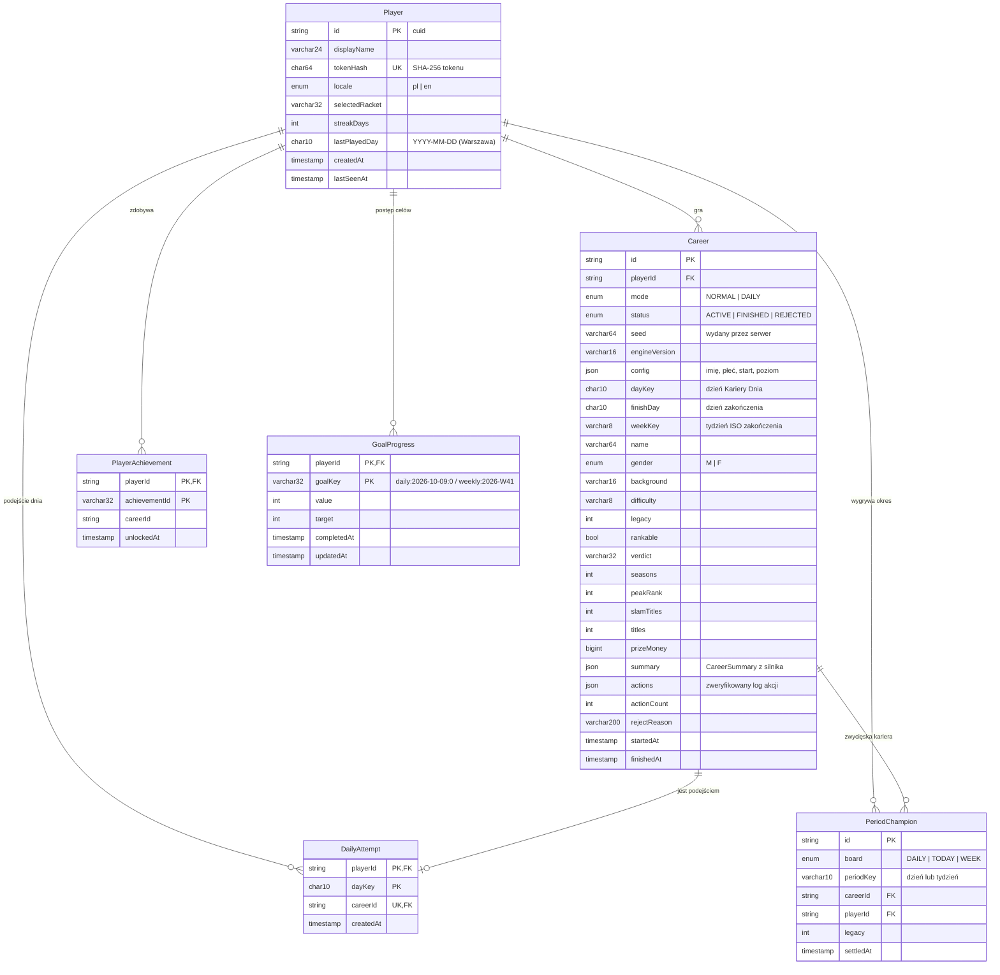
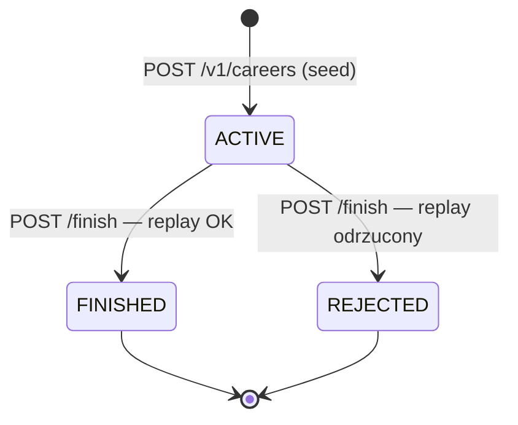

# Schemat bazy danych

> PostgreSQL 16+ · ORM: Prisma 6 · źródło prawdy: [`apps/api/prisma/schema.prisma`](../apps/api/prisma/schema.prisma) · migracje: [`apps/api/prisma/migrations`](../apps/api/prisma/migrations)

Baza przechowuje **wyłącznie metagrę**: konta, zweryfikowane kariery, rankingi, osiągnięcia i cele. Sama rozgrywka nie trafia do bazy w trakcie — klient wysyła log akcji raz, po zakończeniu kariery.

## Diagram ER



## Tabele

### `Player`
Anonimowe konto przypisane do urządzenia. Klient dostaje losowy token (32 bajty, base64url) **jeden raz**; w bazie leży tylko `tokenHash = sha256(token)`. Wyciek bazy nie pozwala więc podszyć się pod gracza. Seria (`streakDays`) rośnie, gdy gracz kończy karierę w kolejnych dniach (strefa Europe/Warsaw); `lastPlayedDay` to ostatni taki dzień.

### `Career`
Jedna kariera = jeden wiersz, tworzony przy **starcie** (status `ACTIVE`, seed wydany przez serwer).
Po wysłaniu logu serwer odtwarza karierę i:
- przy sukcesie ustawia `FINISHED`, wypełnia zdenormalizowane kolumny wyniku (`legacy`, `peakRank`, `slamTitles`…), pełne `summary` i zweryfikowany `actions`,
- przy błędzie ustawia `REJECTED` i `rejectReason` (np. `illegal_action:412:Option unavailable`).

Kolumny wynikowe są zdenormalizowane celowo — rankingi czytają tylko proste kolumny z indeksów, bez parsowania JSON-a. `summary` i `actions` zostają do audytu i ponownej weryfikacji po zmianach silnika.

`rankable = false` dla punktu startowego „Wybraniec” (gra bez rankingu).

### `DailyAttempt`
Realizuje zasadę „liczy się pierwsze podejście”. Wiersz `(playerId, dayKey)` powstaje **w tej samej transakcji co kariera dnia** — drugie `POST /v1/careers {mode:"daily"}` tego dnia kończy się `409`. Porzucenie kariery nie zwraca podejścia.

### `PlayerAchievement`
Osiągnięcia zdobyte przez gracza (identyfikatory z `packages/engine/src/content/achievements.ts`). Klucz złożony gwarantuje, że każde osiągnięcie zapisuje się raz; `careerId` wskazuje karierę, w której zostało zdobyte.

### `GoalProgress`
Postęp celów dnia i wyzwania tygodnia. Klucze są deterministyczne (`daily:{dzień}:{indeks}`, `weekly:{tydzień ISO}`), a definicje celów wylicza silnik z daty — baza trzyma tylko wartości. Postęp jest przeliczany po każdej zakończonej karierze z podsumowań karier danego okresu.

### `PeriodChampion`
Zwycięzcy zamkniętych okresów („Panujący mistrz”) i trofea w Muzeum. `@@unique([board, periodKey])` czyni rozliczenie idempotentnym — kilka instancji API może je uruchamiać równolegle.

## Indeksy i zapytania

| Indeks | Zapytanie |
|---|---|
| `Career (mode, dayKey, legacy DESC)` | ranking Kariery Dnia |
| `Career (mode, finishDay, legacy DESC)` | ranking „tryb zwykły · dziś” |
| `Career (weekKey, legacy DESC)` | ranking tygodniowy |
| `Career (status, legacy DESC)` | ranking wszech czasów |
| `Career (mode, status, finishedAt DESC)` | ostatnie kariery |
| `Career (playerId, status)`, `(playerId, finishDay)` | muzeum, cele gracza |
| `Player (tokenHash)` UNIQUE | uwierzytelnienie każdego żądania |

Ranking „najlepsza kariera gracza w okresie”:

```sql
SELECT * FROM (
  SELECT DISTINCT ON (c."playerId") c.*, p."displayName"
  FROM "Career" c JOIN "Player" p ON p.id = c."playerId"
  WHERE c.status = 'FINISHED' AND c.rankable AND c."mode" = 'NORMAL' AND c."finishDay" = $1
  ORDER BY c."playerId", c.legacy DESC, c."finishedAt" ASC
) best
ORDER BY best.legacy DESC
LIMIT 10;
```

## Cykl życia kariery



## Migracje

```bash
npm run db:up                 # PostgreSQL w Dockerze
npm run db:migrate            # prisma migrate dev (nowa migracja z diffu schematu)
npx -w @ttg/api prisma migrate deploy   # produkcja (robi to też kontener API przy starcie)
```

Zasady: migracje są tylko „do przodu”, każda zmiana schematu = nowy katalog w `prisma/migrations`, nigdy nie edytujemy zastosowanych migracji.

## Retencja i prywatność

- Brak danych osobowych: nazwa wyświetlana jest dowolna, konto jest anonimowe.
- Kariery `ACTIVE` starsze niż 30 dni można bezpiecznie usuwać (porzucone) — zadanie porządkowe opisane w [ROADMAP.md](./ROADMAP.md).
- Usunięcie gracza kaskadowo usuwa jego kariery, osiągnięcia, cele i trofea (`onDelete: Cascade`).
