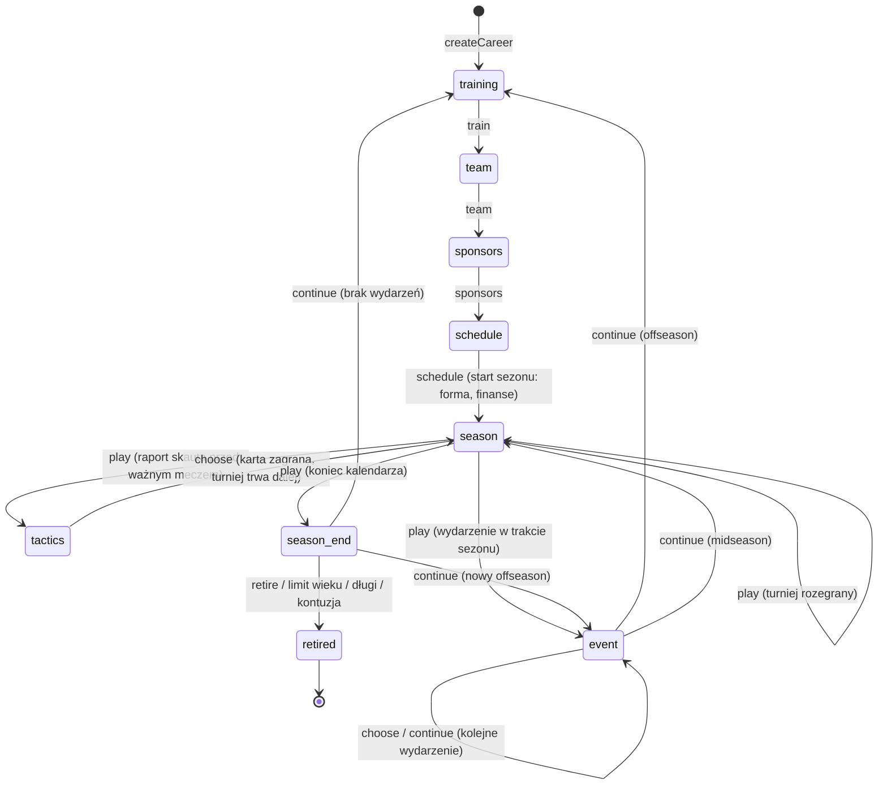

# Silnik symulacji (`@ttg/engine`)

> Czysty TypeScript, zero zależności, działa identycznie w przeglądarce i w Node.
> Wszystkie liczby balansu: [`model/constants.ts`](../packages/engine/src/model/constants.ts) i [`content/`](../packages/engine/src/content).

## 1. Kontrakt

```ts
import { createCareer, step, replay, buildSummary } from '@ttg/engine';

let state = createCareer(config, seed);           // stan początkowy (wiek 8, Tenis 10, faza: trening)
state = step(state, { t: 'train', plan: { skills: { serve: 2, forehand: 2 }, rest: 1, learn: null, preferred: 'baseline' } }); // czysta funkcja
// …
const same = replay(config, seed, actions);        // deterministyczne odtworzenie
const summary = buildSummary(same);                 // LEGACY, werdykt, statystyki
```

| Funkcja | Opis |
|---|---|
| `createCareer(config, seed)` | Losuje potencjał, wzrost, rękę, zaplecze rodziny, pole rywali Tenisa 10. |
| `step(state, action)` | `structuredClone` + `applyAction`. Dla UI. |
| `applyAction(state, action)` | Mutująca wersja — replay klonuje stan raz na całą karierę. |
| `replay(config, seed, actions)` | Używane przez API do weryfikacji. |
| `buildSummary(state, reason)` | `CareerSummary` — wejście dla rankingów, osiągnięć, celów, werdyktu. |
| `botAction(state)` | Rozsądny gracz automatyczny (testy, raport balansu). |

Nielegalna akcja w danej fazie rzuca `EngineError` (serwer zamienia to na `422`).

## 2. Maszyna stanów faz



## 3. Losowość

`Rng` to **xoshiro128\*\*** seedowany hashem **cyrb128** ze stringa. Stan generatora (4 × uint32) jest częścią `CareerState` (`state.rng`) — każda akcja tworzy `Rng` ze stanu, losuje i zapisuje stan z powrotem. Dzięki temu:

- zapis/odczyt w dowolnym momencie nie zmienia przyszłości,
- replay serwera daje identyczny wynik (test `replays to the identical final state`),
- UI nigdy nie losuje — pokazuje tylko to, co policzył silnik (np. przewagę kart w raporcie skauta).

## 4. Model meczu

### 4.1 Zawodnik → kompozyty
| Kompozyt | Gracz | AI |
|---|---|---|
| serwis | 0,62·serwis + 0,23·forhend + 0,15·siatka | rating + offset stylu |
| return | 0,55·return + 0,30·bekhend + 0,15·forhend | rating + offset |
| wymiany | 0,36·forhend + 0,34·bekhend + 0,30·kondycja | rating + offset |
| psychika | psychika | rating ± N(0, 5) |

Style AI: `server` (+5 serwis), `grinder` (+4 wymiany, +5 kondycja), `netrusher` (+3 serwis, +2 na trawie), `allround`.

### 4.2 Punkt
```
p(serwujący wygrywa punkt) = baza[nawierzchnia]
  + w_serve[naw] · (serwisA − returnB) / 100
  + w_rally[naw] · (wymianyA − wymianyB) / 100
  + 0,001 · (biegłośćA − biegłośćB)
  + bonusA − bonusB                         // forma sezonu + forma dnia + momentum − zmęczenie
  + 0,012 jeśli serwujący jest leworęczny, a rywal nie
  + 0,0015 · (psychikaA − psychikaB)        // tylko punkty pod presją
p ∈ [0,28; 0,90]
```

| Nawierzchnia | baza | w_serve | w_rally |
|---|---|---|---|
| mączka | 0,57 | 0,17 | 0,21 |
| twarda | 0,61 | 0,22 | 0,15 |
| hala | 0,63 | 0,25 | 0,13 |
| trawa | 0,65 | 0,27 | 0,11 |

Punkty pod presją: break point, każdy punkt tie-breaka, decydujący set od 4:4. Zmęczenie w meczu: od drugiego seta `−0,0005 · max(0, 70 − kondycja) · nrSeta`.

### 4.3 Dwie prędkości
- **Mecze gracza** — punkt po punkcie (`playGamePoints`, `playTiebreakPoints`), wznawialne na granicy setów (`MatchProgress`).
- **Mecze AI vs AI** — gem po gemie z zamkniętego wzoru na utrzymanie serwisu:
  `P_hold(p) = p⁴(1 + 4q + 10q²) + 20p³q³ · p² / (1 − 2pq)`, liczonego raz na set.
- **Wirtualne ITF-y** (zawodnicy bez miejsca w widocznych turniejach) — jedno losowanie na mecz z krzywej logistycznej `1 / (1 + e^(−Δrating/7,5))`.

Kalibracja (skrypt `fairness.ts`): równi zawodnicy ≈ 50%, +2 ratingu ≈ 57%, +5 ≈ 66%, +10 ≈ 80%.

### 4.4 Taktyki (`sim/tactics.ts`, `content/tactics.ts`)
Kluczowy mecz (półfinał+, duże turnieje od 1/8, mecz z Nemesis, losowo 15% pozostałych) pauzuje **przed pierwszą piłką** w fazie `tactics` z raportem skauta (`PendingTactics`: styl, ręka, różnica siły, nawierzchnia, opcje z przewagą każdej karty). Akcja `choose` gra kartę i od razu wznawia turniej.

```
pp     = (vsStyle[styl_rywala] + surface[nawierzchnia]) · 0,35
       + (Σ wᵢ·skillᵢ / Σ wᵢ − OVR) · 0,05
       + mistrzostwo · 0,15                      // poziomy za 6 / 18 / 40 wygranych
edge   = clamp(pp, −4, 4) / 100                   // do szansy punktu przy serwisie i returnie
spread = ryzyko_karty · 1,5 / 100
w każdym secie: bonus += edge + N(0, spread)
```
Zwykłe mecze grają kartą `tactics.preferred` z mnożnikiem `AUTOPILOT_FACTOR = 0,5`. Każdy mecz trafia do `tactics.record[karta]` (rozegrane/wygrane), co buduje mistrzostwo.

### 4.5 Trening blokowy
Akcja `train` niesie `TrainingPlan { skills, rest, learn, preferred }`. Liczba bloków: 5, +1 (trener z akademii lub lepszy), +1 (trener przygotowania). Zysk n bloków na jednym skillu: `g · Σ 0,75ᵏ`, gdzie `g = bonus_trenera · max(0,45; f(wiek)) · 0,3 · zapas_do_potencjału`. Blok odpoczynku: −6 zmęczenia, +3 humoru, −7% ryzyka kontuzji w sezonie. Nauka karty kosztuje `TACTIC_BLOCK_COST = 2` bloki i jest możliwa tylko dla kart obecnego trenera. `validateTraining` odrzuca plany niewykorzystujące dokładnie wszystkich bloków.

## 5. Turnieje

- **Drabinka**: klasyczne rozstawienie (`seedOrder`: 1–n, n/2+1…), grupy rozstawionych 3–4, 5–8, 9–16 losowane, wolne losy dla najwyżej rozstawionych przy niepełnym polu.
- **Wejście (zawodowstwo)**: ranking ≤ cutoff MD → drabinka; exempt juniorski (TOP 10 juniorów → 3 Challengery); dzika karta (`0,03 + media·0,004 + reputacja·0,003 − kara_rangi`, +45 pp w Polsce); kwalifikacje (2–3 rundy); w ITF M15 zawsze.
- **Finały sezonu**: TOP 8, dwie grupy round-robin, półfinały A1–B2 / B1–A2. Punkty 200 za zwycięstwo w grupie, +400 SF, +500 F.
- **Igrzyska**: 64 zawodników (TOP 56), mecz o brąz między przegranymi półfinalistami.
- **Wznawialność**: `TournamentRun` przechowuje drabinkę bieżącej rundy; mecz gracza w rundzie gra się pierwszy, potem mecze AI tej rundy.

### 5.1 Prognoza turnieju (`sim/outlook.ts`)

`tournamentOutlook(state, def)` — czysta funkcja bez RNG: typowy rywal w każdej rundzie (juniorzy: ważone kwantyle pola wg `JUNIOR_TIER`; zawodowcy: `ratingForRank` z pasma rangi, ×0,55 rankingu na rundę), szansa na wygranie 1. meczu (`winChance(gap) = 1/(1+e^(−gap/6))`, dopasowane do symulowanych meczów), typowy wynik (mediana rundy odpadnięcia), oczekiwane punkty i werdykt (*faworyt* ≥ 65%, *wyrównany* ≥ 45%, *outsider* ≥ 25%, *bez szans*, *brak wejścia*). Używają jej terminarz, karta „Następny przystanek” i `autoPlan` (wybiera turniej o najwyższych oczekiwanych punktach).

## 6. Pule zawodników i ranking

| Etap | Pole | Ranking |
|---|---|---|
| Tenis 10 | 39 rywali (PL) | suma punktów sezonu |
| Krajowy | 79 (12 przeniesionych + nowi) | j.w. |
| Tennis Europe | 79 (20% PL) | j.w. |
| ITF Juniors | 127 (7% PL) | j.w., nr 1 na koniec roku = osiągnięcie |
| Zawodowstwo | 420 AI + gracz | rolling 52 tyg., 19 najlepszych wyników |

- **Poziomy turniejów juniorskich** (`JUNIOR_TIER`, 0–1): turniej losuje drabinkę z wycinka pola dopasowanego do swojej rangi (rozkład normalny wokół kwantyla `1 − tier`, σ = 0,18). Kat. B / TE3 / J60 to słabsza połowa pola, Mistrzostwa Polski / Europy / juniorskie Szlemy — czołówka.
- Rywale juniorscy są **trwali** i przechodzą z etapu na etap; najgroźniejszy dostaje flagę **Nemesis** (zawsze przenoszony, własne wydarzenia, sytuacje meczowe).
- Pula zawodowa startuje z syntetycznymi wynikami (16 wyników rozłożonych na 52 tygodnie wg `pointsForRank`), które naturalnie „wygasają”.
- Co tydzień: rozdział AI na turnieje tygodnia wg rankingu i prestiżu (najlepsi częściej opuszczają 250/500), reszta dolnej połowy gra wirtualne ITF-y.
- **Pasma obsady** (`FIELD_BAND`): każda ranga ma typowe pasmo rankingowe (np. ITF M15 #350–#3000, Challenger 75 #110–#420). Nikt z rankingiem lepszym niż dolna granica pasma nie „schodzi” do mniejszego turnieju. ITF-y biorą z puli tylko rozstawionych (6/12 graczy); resztę drabinki i rywali w kwalifikacjach uzupełniają **lokalni zawodnicy** (`createLocal`, `season.locals`) z ratingiem z `ratingForRank` — żyją jeden tydzień i nie wchodzą do rankingu.
- Ranking poza symulowaną pulą jest **ekstrapolowany z punktów** (`rankFromPoints`) — dlatego słaby debiutant widzi np. #1700, a nie #421.
- Co sezon: rozwój/regres AI, emerytury (od 30 lat), debiutanci 18–20 lat, a **kalibracja puli** ściąga rozkład ratingów do krzywej `ratingForRank` (#1 ≈ 94,5, #10 ≈ 87,5, #100 ≈ 80,5) — tour nie „deflacjonuje” przez dekady.

## 7. Rozwój zawodnika

```
przyrost_skilla = max(0, potencjał − skill) · 0,14 · f(wiek) · mnożnik_trenera · chemia · U(0,8; 1,2)
trening_zimowy  = bonus_trenera · max(0,45, f(wiek)) · clamp((potencjał + 2 − skill) / 8, 0,15, 1)
```
`f(wiek)`: 8–12 → 1,0 · 13–16 → 1,15 · 17–20 → 1,0 · 21–24 → 0,75 · 25–28 → 0,35 · potem regres (kondycja najszybciej). Chemia z trenerem: +2% za sezon współpracy (max +8%). Biegłość na nawierzchni rośnie z każdym meczem: `+ (88 − biegłość) · 0,012`.

## 8. Ekonomia

Na start sezonu: wsparcie rodziny (do 24. roku życia), pensje sztabu, sprzęt (−70% z kontraktem rakietowym), stypendium PZT dla juniorów z TOP 5, kontrakty sponsorskie. W trakcie: koszt wyjazdu na każdy turniej (region × ranga; ITF ×0,5, Challenger ×0,8, hospitality −45%), premie. Agent: sponsorzy ×1,4, premie ×0,85. Długi: junior < −60 tys., zawodowiec < −150 tys. zł → ostrzeżenie (wydarzenie „Rodzina sprzedaje działkę”), a przy kolejnym końcu sezonu — koniec kariery.

## 9. Balans — jak sprawdzać

```bash
npm run balance -- 40                                   # 40 karier na każdy punkt startowy
npx tsx packages/engine/scripts/trajectory.ts academy 3 # jedna kariera sezon po sezonie
npx tsx packages/engine/scripts/fairness.ts             # kalibracja modelu meczu
```

Stan na v1.0.0 (16 karier / tło, bot):

| Start | Mediana najwyższego rankingu | TOP 100 | TOP 10 | Mediana LEGACY |
|---|---|---|---|---|
| Ściana za blokiem | ~#600 | ~20% | ~12% | niskie, długi ogon do ~3800 |
| Dziecko prezesa | ~#350 | ~38% | ~25% | ~75 (p90 ~6700) |
| Talent z akademii | ~#40 | ~80% | ~45% | ~900 (×0,6) |
| Wybraniec | #1 | 100% | 100% | bez rankingu |

Zasada: **potencjał ≈ szczytowy OVR** (trening dodaje ~+2–4), a krzywa OVR → ranking: 74 ≈ #150, 80 ≈ #60, 84 ≈ #40, 86 ≈ #10, 90+ ≈ nr 1.

## 10. Testy

`packages/engine/test`: RNG (determinizm, wznawianie, rozkład), model meczu (legalne wyniki setów, fairness, pauza/wznowienie, zapis wyniku), drabinki (rozstawienie, wolne losy), ranking (19 najlepszych, okno 52 tyg., odwracalność krzywych), kariery (pełne kariery botem, replay, kolejność etapów, spójność statystyk), integralność treści (unikalne id, zbalansowane znaczniki `[[m|f]]`), metagra (Kariera Dnia, tygodnie ISO).
